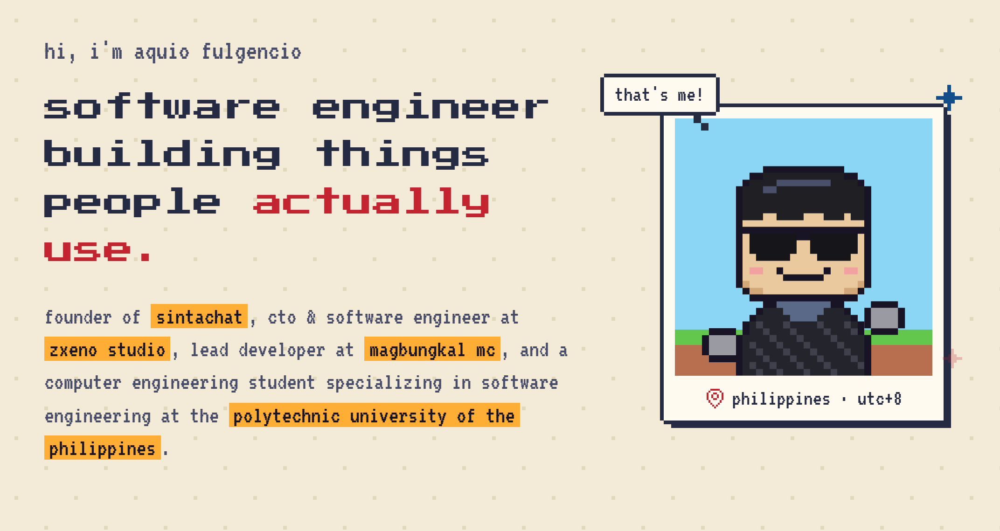
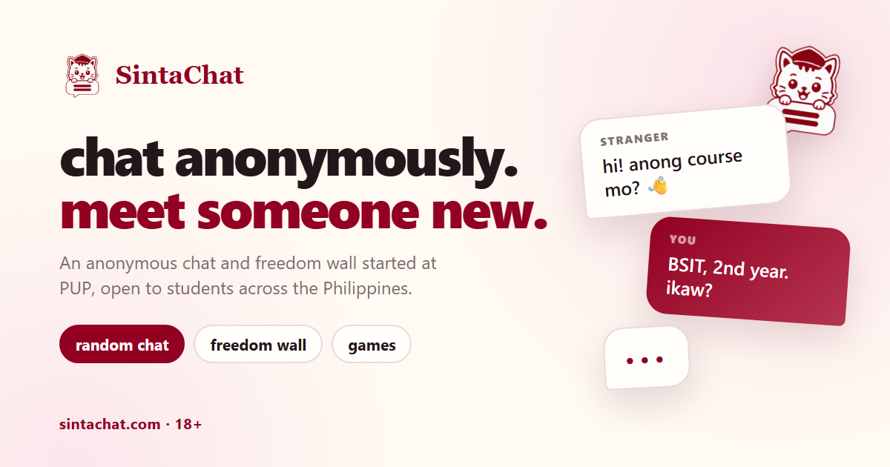
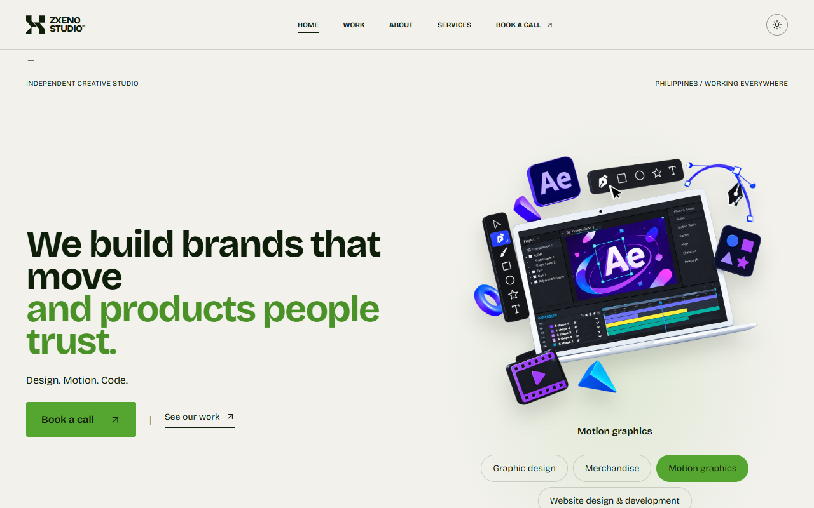
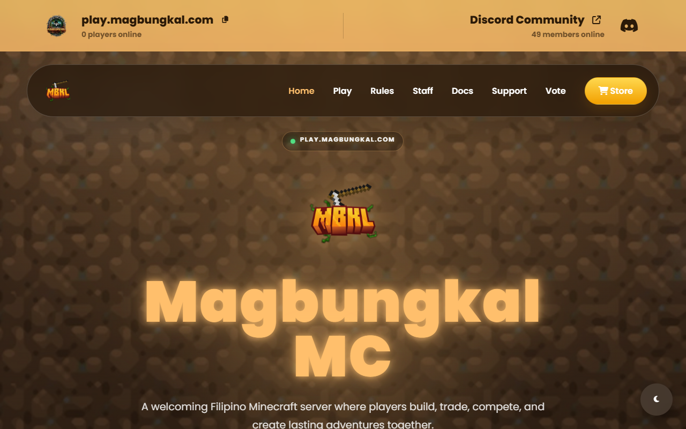
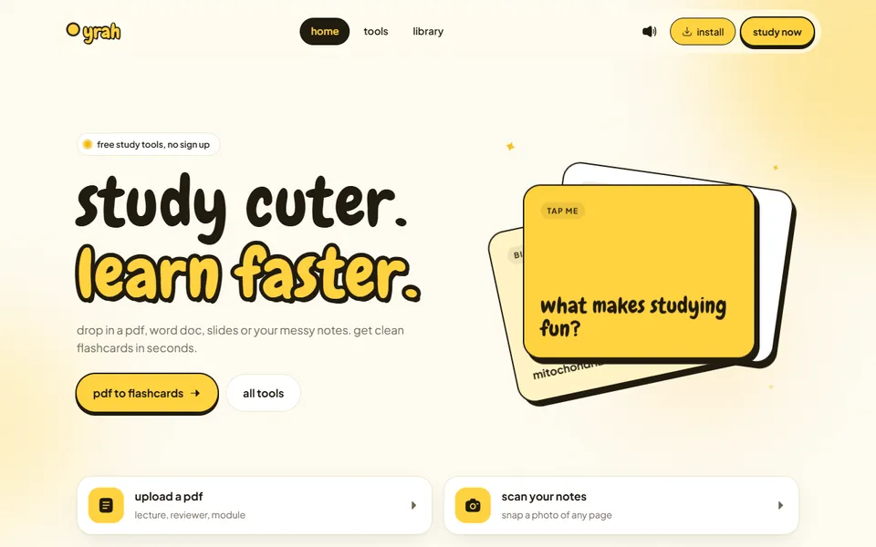
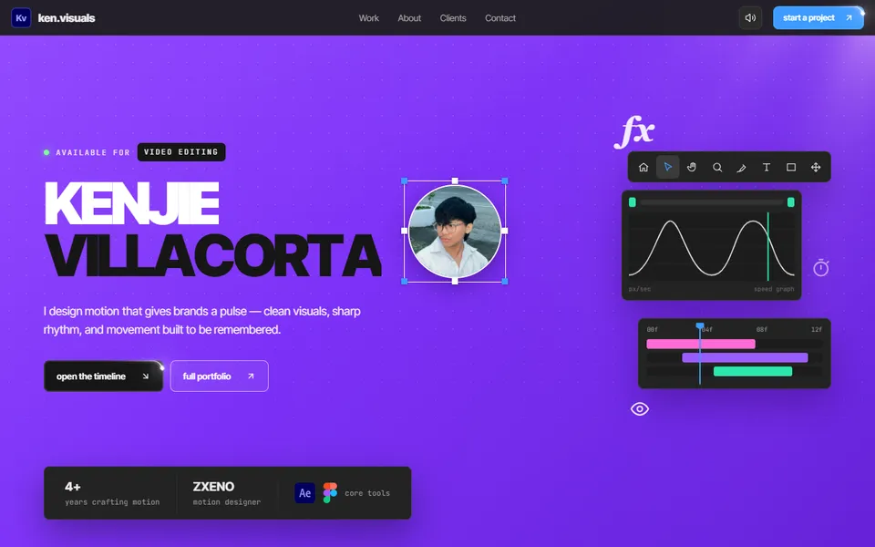
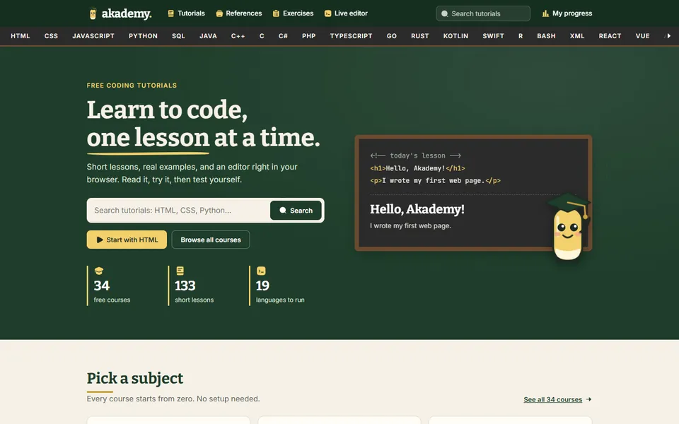

<a href="https://akiakyo.dev">
  <picture>
    <source media="(prefers-color-scheme: dark)" srcset="assets/banner-dark.png">
    
  </picture>
</a>

  
  
  
  

## about

`> what i do`

i'm a computer engineering student specializing in software engineering who likes turning ideas into products people can actually use.

most of my learning comes from shipping real projects, solving technical problems, and improving products as they grow.

**things i work on:** frontend · backend · real-time systems · apis · databases · deployment · ui/ux

## experience

`> current roles`

<table>
  <tr>
    <td width="45%"></td>
    <td width="55%">&nbsp;<b><a href="https://sintachat.com">sintachat</a></b> &nbsp;founder  leading product direction and engineering for a real-time anonymous student chat platform: matchmaking, moderation, community features, edge infrastructure, and deployment.  next.js · react · typescript · cloudflare workers · durable objects · websockets · d1</td>
  </tr>
  <tr>
    <td width="45%"></td>
    <td width="55%">&nbsp;<b><a href="https://zxenostudio.com">zxeno studio</a></b> &nbsp;cto · software engineer  technical direction and software engineering for the studio, from implementation decisions and web development to deployment workflows and production-ready experiences.  react · typescript · vite</td>
  </tr>
  <tr>
    <td width="45%"></td>
    <td width="55%">&nbsp;<b><a href="https://magbungkal.com">magbungkal mc</a></b> &nbsp;lead developer  leading development for magbungkal mc, a filipino minecraft community, and maintaining its web presence.  html · javascript</td>
  </tr>
</table>

&nbsp;**polytechnic university of the philippines**: computer engineering student, specialization in software engineering.

## side projects

`> things i built for fun & friends`

<table>
  <tr>
    <td width="33%" valign="top"> <b><a href="https://yrah.vercel.app">yrah</a></b> free flashcard maker  turn pdfs, word docs, slides, notes and photos of your notebook into flashcards in seconds. no sign up, works offline.</td>
    <td width="33%" valign="top"> <b><a href="https://kenvisuals.vercel.app">ken.visuals</a></b> portfolio for a motion designer  an editor-inspired interface of timelines, speed graphs and tool panels.</td>
    <td width="33%" valign="top"> <b><a href="https://akademyy.vercel.app">akademy</a></b> free coding tutorials  34 courses and 133 short lessons in a chalkboard theme, with a live editor, flashcards, quizzes and certificates.</td>
  </tr>
</table>

## tech stack

`> languages, frameworks & tools`

**languages** 

**web & frontend** 

**backend & realtime** 

**databases** 

**development & deployment** 

**creative tools** 

## contact

`> let's build something`

want to work together? reach out for software projects, collaborations, product work, or engineering opportunities.

— aquio
